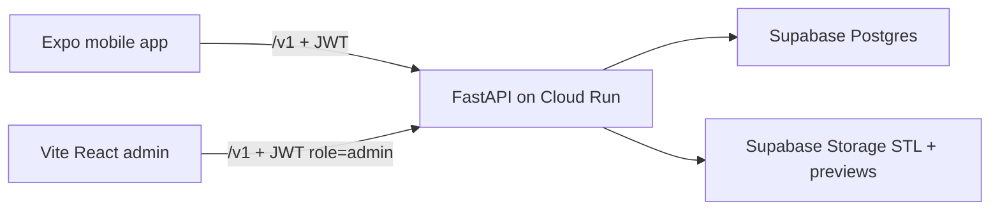

# AGENTS.md — 3D Printing E-commerce

Guidance for AI agents and developers working in this repository.

## Project overview

**3D Printing E-commerce** is a scalable, enterprise-oriented 3D-printing storefront. Customers browse and customize 3D print models (color, size), upload custom STL files for instant quotes, manage addresses, checkout, and track orders. Admins maintain catalog inventory, pricing, delivery zones, and the production print queue.

Built on the **product-blueprint** house stack with a deliberate deviation: the catalog is **global/admin-owned**, not per-user.

| App | Path | Purpose |
|-----|------|---------|
| Backend API | `backend/` | FastAPI REST API, Supabase Postgres, JWT auth |
| Mobile customer app | `mobile/` | Expo SDK 54 — Shop, Cart, Orders, Profile, Support |
| Web admin console | `admin/` | Vite + React + TS — inventory, orders, queue, pricing |
| Database schema | `db/schema.sql` | Postgres DDL for Supabase |

**Locale / currency:** `en-IN` / **INR**

**Reference printer:** Bambu Lab A1 (256 × 256 × 256 mm build volume, up to 4 colors with AMS lite)

---

## Architecture



**Auth flow:** Google identity token → `POST /v1/auth/google` → first-party JWT (HS256, `sub`=user id, `role` embedded) → Bearer on all protected routes.

**Data access:** Supabase client uses the **service-role key** (bypasses RLS). Tenant isolation is enforced in application code, not Postgres RLS.

---

## Stack (non-negotiable)

| Layer | Choice |
|-------|--------|
| Mobile | Expo SDK 54, expo-router, React Native 0.81, React 19, TypeScript strict |
| Mobile UI | `@neo-design-library/mobile` — dark-mode-first, design tokens only |
| Mobile data | `@tanstack/react-query`, JWT in `expo-secure-store` |
| Admin web | Vite 6, React 19, React Router 7, TanStack Query |
| API | Python 3.13, FastAPI 0.115, Uvicorn, Pydantic v2 |
| Database | Supabase (PostgreSQL) via `supabase-py` service-role key |
| Auth | Google OAuth → first-party JWT |
| Rate limiting | SlowAPI + Upstash Redis (`memory://` fallback) |
| Observability | structlog JSON, Prometheus `/metrics`, `/health`, security headers |
| Deploy target | Docker → Cloud Build → Cloud Run (API); EAS (mobile) |

Canonical blueprint source: `/Users/gchidambaranathan2/Documents/myprojects/product-blueprint/`

---

## Tenancy model (critical)

The product-blueprint assumes every table has `user_id`. This project **splits entities**:

### Global / admin-owned (no `user_id`)

Writes require `CurrentAdmin` (`role='admin'` in JWT, else 403). Reads are public or auth-optional.

| Table | Purpose |
|-------|---------|
| `categories` | Product taxonomy (hierarchical via `parent_id`) |
| `products` | 3D print models (name, price, weight, dimensions, status) |
| `product_categories` | M2M: product ↔ category |
| `product_colors` | M2M: product ↔ color |
| `color_palette` | Global filament colors (`hex_code`, `in_stock`) |
| `pricing_config` | Admin-managed rates for price calculator |
| `serviceable_pincodes` | Delivery availability + ETA by pincode |
| `print_jobs` | Production queue (queued / printing / completed / failed) |

### Per-user (must filter `.eq("user_id", current_user["id"])` on every query)

| Table | Purpose |
|-------|---------|
| `users` | Profile + `role` (`customer` \| `admin`) |
| `addresses` | Delivery addresses |
| `cart_items` | Shopping cart with customization (colors, size, scale) |
| `orders` | Placed orders + status tracker |
| `order_items` | Line items (snapshot name, price, colors, dimensions) |
| `stl_uploads` | Custom user STL metadata + quoted price |

**Admin bootstrap:** set `ADMIN_EMAILS` (comma-separated) in backend env. Matching emails get `role='admin'` on Google sign-in.

---

## 3D domain rules

Constants live in `backend/api/config.py` and are mirrored in `mobile/types/catalog.ts` as `BUILD_LIMITS`.

| Rule | Value |
|------|-------|
| Build plate width | 256 mm |
| Build plate depth | 256 mm |
| Max print height | 256 mm |
| Max colors per print | 4 |
| Default filament density (PLA) | 1.24 g/cm³ |

### Product statuses

`draft` → `active` → `out_of_stock` → `archived`

Only `active` products are visible to non-admin customers on catalog GET endpoints.

### Order statuses

`pending` → `confirmed` → `printing` → `shipped` → `delivered` (or `cancelled`)

Customers may only cancel their own orders. Admins advance status via admin console or `PATCH /v1/orders/{id}/status`.

### Print price calculator

Implemented in `backend/api/services/pricing.py`:

```
price = (material + electricity + labor) × (1 + margin)

material    = weight_g × filament_price_per_gram
electricity = (printer_power_w / 1000) × print_hours × electricity_rate_per_kwh
labor       = print_hours × labor_rate_per_hour
```

Rates come from the active `pricing_config` row. If print time is omitted, estimate ~2 min/gram. Weight can be derived from STL volume: `weight = volume_cm3 × 1.24`.

### Cart customization validation (`backend/api/routers/cart.py`)

- At most `min(product.max_colors, MAX_COLORS)` selected colors
- `width_mm`, `depth_mm`, `height_mm` must not exceed build volume limits

---

## Repository layout

```
3d-commerce/
├── AGENTS.md                 ← this file
├── README.md                 ← human setup guide
├── db/
│   └── schema.sql            ← apply in Supabase SQL editor
├── backend/
│   ├── Dockerfile
│   ├── cloudbuild.yaml
│   └── api/
│       ├── main.py           ← app factory, router registration
│       ├── config.py         ← settings + domain constants
│       ├── dependencies.py   ← CurrentUser, CurrentAdmin, OptionalUser, JWT
│       ├── limiter.py
│       ├── schemas/models.py ← all Pydantic Create/Update/Response models
│       ├── routers/          ← one module per resource
│       ├── services/         ← supabase_client, google_auth, pricing
│       ├── middleware/
│       └── tests/
├── mobile/
│   ├── app/                  ← expo-router screens
│   │   ├── _layout.tsx       ← providers + AuthGate
│   │   ├── (auth)/login.tsx
│   │   ├── (tabs)/           ← Shop, Cart, Orders, Profile, Support
│   │   ├── product/[id].tsx  ← model detail + customization
│   │   ├── checkout.tsx
│   │   ├── upload.tsx        ← STL upload + price quote
│   │   └── address/new.tsx
│   ├── components/
│   ├── hooks/                ← React Query per resource
│   ├── types/                ← camelCase UI types
│   ├── services/api.ts
│   ├── lib/queryClient.ts
│   └── context/AuthContext.tsx
└── admin/
    └── src/
        ├── App.tsx           ← routes + sidebar layout
        ├── api.ts            ← fetch wrapper + token storage
        ├── auth.tsx
        └── pages/            ← Products, Categories, Colors, Orders, Queue, Pricing, Delivery
```

---

## API reference

Base URL: `http://localhost:8000` (dev). All data routes under `/v1`. Health at `/health`, metrics at `/metrics`.

### Auth & users

| Method | Path | Auth | Description |
|--------|------|------|-------------|
| POST | `/v1/auth/google` | Public | Exchange Google ID token → JWT |
| GET | `/v1/users/me` | Bearer | Current user profile |
| PATCH | `/v1/users/me` | Bearer | Update name, phone |

### Catalog (reads public; writes admin)

| Method | Path | Auth | Description |
|--------|------|------|-------------|
| GET | `/v1/products` | Optional | List; `q`, `category`, `sort`, `status` (admin only) |
| GET | `/v1/products/{id}` | Optional | Detail with categories + colors |
| POST/PATCH/DELETE | `/v1/products` | Admin | CRUD + M2M category/color links |
| GET/POST/PATCH/DELETE | `/v1/categories` | Public read / Admin write | Taxonomy |
| GET/POST/PATCH/DELETE | `/v1/colors` | Public read / Admin write | Color palette |

**Product sort values:** `newest`, `price_asc`, `price_desc`, `name`, `featured`

### Commerce (per-user)

| Method | Path | Auth | Description |
|--------|------|------|-------------|
| GET/POST/PATCH/DELETE | `/v1/cart` | Bearer | Cart CRUD |
| GET/POST/PATCH/DELETE | `/v1/addresses` | Bearer | Address book |
| GET/POST | `/v1/orders` | Bearer | List orders / checkout cart |
| GET | `/v1/orders/{id}` | Bearer | Order detail + items |
| PATCH | `/v1/orders/{id}/status` | Bearer (admin or cancel) | Status update |

**Checkout:** `POST /v1/orders` with `{ address_id }` — snapshots cart → order_items, enqueues print_jobs, clears cart. Flat shipping fee ₹49.

### STL upload & pricing

| Method | Path | Auth | Description |
|--------|------|------|-------------|
| GET/POST/DELETE | `/v1/uploads` | Bearer | User STL metadata + auto-quote |
| GET | `/v1/pricing/config` | Public | Active pricing rates |
| PATCH | `/v1/pricing/config` | Admin | Update rates |
| POST | `/v1/pricing/quote` | Public | Calculate price from weight or volume |

### Delivery & print queue

| Method | Path | Auth | Description |
|--------|------|------|-------------|
| GET | `/v1/delivery/check?pincode=` | Public | Serviceability + ETA |
| GET/POST/DELETE | `/v1/delivery/pincodes` | Admin | Manage serviceable pincodes |
| GET | `/v1/print-jobs/queue` | Public | Queue summary (queued, printing, est wait) |
| GET/PATCH | `/v1/print-jobs` | Admin | Full job list + status transitions |

---

## Backend conventions

Follow product-blueprint `conventions/backend.md` unless overridden below.

### Routing

- Prefix: `/v1/<plural-kebab-case>`
- Per resource: `XCreate`, `XUpdate`, `XResponse(OrmBase)`, `XPageResponse` in `schemas/models.py`
- Register new routers in `main.py` `for router in (...)` loop
- `@limiter.limit("60/minute")` on every endpoint; function must take `request: Request`

### Query rules

- **Per-user tables:** every query MUST include `.eq("user_id", current_user["id"])`
- **Catalog tables:** no user_id filter; mutations use `CurrentAdmin`
- Convert before write: `str(Decimal)`, `date.isoformat()`, `str(UUID)`
- PATCH: `model_dump(exclude_none=True)`; 404 when `result.data` is empty on update/delete
- Never leak stack traces — global handler returns `{"detail": "Internal server error"}`

### Adding a new backend resource

1. Add table to `db/schema.sql` (CHECK constraints mirror Pydantic `Field(...)`)
2. Add Pydantic models to `schemas/models.py`
3. Clone an existing router (e.g. `routers/categories.py`) → new module
4. Register in `main.py`
5. Add row factory + tests in `tests/helpers.py` and `tests/test_*.py`
6. Patch `get_supabase` in `tests/conftest.py` `mock_supabase` module list

### Tests

```bash
cd backend && source .venv/bin/activate && pytest api/tests -q
```

Current suite: **27 tests** (products, cart, orders, pricing, catalog). Uses `SupabaseMock` — no real DB required.

---

## Mobile conventions

Follow product-blueprint `conventions/frontend.md`. Load the **neo** skill for design-system APIs.

### Routing

- `app/_layout.tsx`: providers → `AuthGate` redirects `(auth)` ↔ `(tabs)`
- Tabs: Shop (`index`), Cart, Orders, Profile, Support
- Stack screens: `product/[id]`, `checkout`, `upload`, `address/new`

### Data flow

```
Screen → useXQuery hook → services/api.ts → FastAPI
```

- Hooks in `hooks/use*Query.ts` map **snake_case API ↔ camelCase UI**
- Per-user query keys namespaced by `userId` in `lib/queryClient.ts`
- Mutations: optimistic update (onMutate snapshot → onError rollback → onSettled invalidate)
- On 401: `services/api.ts` clears token + emits `sessionEvents`

### Design system

- Import from `@neo-design-library/mobile`: `Button`, `Card`, `Text`, `colors`, `spacing`, `radii`
- **Dark-mode-first** — never white/light backgrounds
- `Button` variants: `primary`, `secondary`, `ghost`, `danger`, `success`
- Neo `Text`/`Card` `style` props expect a single style object — use `StyleSheet.flatten([...])` for conditional styles, not style arrays

### App identifiers

| Key | Value |
|-----|-------|
| Display name | 3D Print Shop |
| Slug | `3d-print-shop` |
| Scheme | `threedprint` |
| Bundle ID | `com.threedprint.app` |

### Verification

```bash
cd mobile && npx tsc --noEmit && npx expo start
```

---

## Admin conventions

- Vite env prefix: `VITE_*`
- Token in `localStorage` key `3dprint_admin_token`
- All admin pages consume the same `/v1` API; admin role enforced server-side
- Login: Google GIS button (`VITE_GOOGLE_CLIENT_ID`) or manual JWT paste
- Pages: Products (CRUD + status), Categories, Colors, Orders (advance status), Print Queue, Pricing config, Delivery pincodes

### Verification

```bash
cd admin && npm run build
```

---

## Environment variables

### Backend (`backend/api/.env`)

| Variable | Required | Description |
|----------|----------|-------------|
| `SUPABASE_URL` | Yes | Supabase project URL |
| `SUPABASE_SERVICE_KEY` | Yes | Service-role key (never client-side) |
| `JWT_SECRET` | Yes | HS256 signing secret |
| `GOOGLE_CLIENT_ID` | Yes (prod) | Google OAuth audience |
| `ADMIN_EMAILS` | No | Comma-separated admin bootstrap emails |
| `ALLOWED_ORIGINS` | No | CORS origins (include `8081`, `5173`) |
| `STORAGE_BUCKET` | No | Default `models` |
| `UPSTASH_REDIS_*` | No | Shared rate-limit storage |

### Mobile (`mobile/.env`)

| Variable | Description |
|----------|-------------|
| `EXPO_PUBLIC_API_URL` | Backend base URL |
| `EXPO_PUBLIC_GOOGLE_CLIENT_ID` | Google OAuth (Expo) |
| `EXPO_PUBLIC_GOOGLE_IOS_CLIENT_ID` | iOS client id |
| `EXPO_PUBLIC_GOOGLE_ANDROID_CLIENT_ID` | Android client id |

### Admin (`admin/.env`)

| Variable | Description |
|----------|-------------|
| `VITE_API_URL` | Backend base URL |
| `VITE_GOOGLE_CLIENT_ID` | Google OAuth (web) |

---

## Local development

```bash
# 1. Apply schema
#    Paste db/schema.sql into Supabase SQL editor

# 2. Backend
cd backend
python3.13 -m venv .venv && source .venv/bin/activate
pip install -r api/requirements.txt
cp api/.env.example api/.env   # fill secrets
uvicorn api.main:app --reload  # → http://localhost:8000/docs

# 3. Mobile
cd mobile && npm install && cp .env.example .env
npx expo start

# 4. Admin
cd admin && npm install && cp .env.example .env
npm run dev                      # → http://localhost:5173
```

---

## Verification checklist

Before marking work complete:

- [ ] Backend boots; `GET /health` returns `{"status":"ok",...}`
- [ ] `GET /docs` lists all `/v1` routes
- [ ] `pytest api/tests` green
- [ ] Every per-user router query has `.eq("user_id", ...)`
- [ ] Every catalog mutation uses `CurrentAdmin`
- [ ] Mobile `npx tsc --noEmit` clean
- [ ] Admin `npm run build` clean

---

## Known gaps / roadmap

These are scaffolded but not fully wired:

1. **STL 3D preview** — mobile upload accepts files and quotes from volume; no `expo-gl`/Three.js mesh viewer yet
2. **Supabase Storage signed uploads** — `stl_uploads.file_url` and `STORAGE_BUCKET` exist; signed URL flow not implemented
3. **Payment gateway** — checkout creates orders without payment capture
4. **Product grid color swatches** — shop list shows price/weight; swatches on detail page only
5. **EAS / Cloud Run deploy** — Dockerfile and cloudbuild.yaml copied from blueprint; GCP/EAS IDs are placeholders in `mobile/app.json`

When extending, prefer minimal diffs that match existing patterns. Do not introduce Tailwind, light-mode defaults, or per-user catalog tables.

---

## Agent rules

### Do

- Read this file and the relevant app folder before making changes
- Match existing naming: snake_case (API/DB), camelCase (mobile/admin UI)
- Filter per-user data by `user_id` on every Supabase query
- Gate catalog writes with `CurrentAdmin`
- Use `Decimal` / `NUMERIC(12,2)` for money — never float
- Use neo design tokens on mobile — dark-mode-first
- Clone existing router/hook patterns when adding resources
- Run the verification checklist after substantive changes

### Do not

- Edit the plan file in `.cursor/plans/` unless explicitly asked
- Commit secrets (`.env` files)
- Rely on Postgres RLS — the service-role key bypasses it
- Expose stack traces in API responses
- Add `user_id` to catalog tables
- Use style arrays on neo `Text`/`Card` without `StyleSheet.flatten`
- Over-engineer helpers for one-off logic
- Create git commits unless the user explicitly asks

### Skills to load when relevant

| Skill | When |
|-------|------|
| `product-blueprint` | Scaffolding new resources, stack questions |
| `neo` | Mobile UI components and tokens |
| `create-rule` | Adding `.cursor/rules/` |

---

## Seed data

`db/schema.sql` includes defaults:

- **8 colors:** Black, White, Red, Blue, Green, Yellow, Orange, Gray
- **5 categories:** Miniatures, Functional, Home Decor, Toys, Prototyping
- **1 pricing_config row:** filament ₹2.50/g, electricity ₹8/kWh, 100W printer, labor ₹60/h, 20% margin

Add sample products via the admin console after first deploy.
